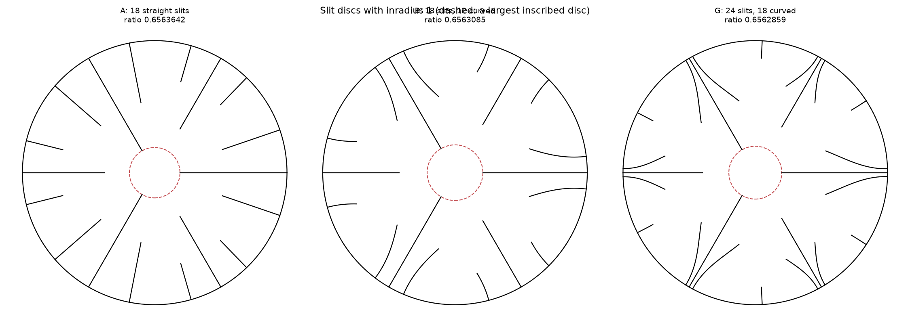

# Slit discs and the upper bound for the univalent Bloch–Landau constant

**DRAFT — private, not submitted. The computer-assisted proof in Section 7 is new (2026-10-13) and is still being audited. Author: Wynand van Staden. Prepared with substantial AI assistance; see the disclosure at the end.**

## Abstract

The univalent Bloch–Landau constant $\mathcal U$ is the largest number such that the image of the unit disc under any univalent $f$ with $|f'(0)|=1$ contains a disc of radius $\mathcal U$. The best bound obtained from an explicit formula is $\mathcal U\le0.6563937$ (Carroll and Ortega-Cerdà, 2009); the best numerical value in the literature is $\mathcal U\le0.656319277$ (Ortega-Cerdà and Pridhnani, 2010), stated without rigorous error analysis. We describe an explicit disc with 24 slits whose ratio of inradius to conformal radius is, numerically, $0.656285866$. The conformal radius is computed by a spectral method for a first-kind integral equation in the logarithmic coordinate, which reproduces the exactly solvable cases to machine precision; the values have been reproduced by independently written code using different methods. A computer-assisted proof in ball arithmetic gives $\mathcal U\le0.65628589$ for this domain (Section 7; under audit).

## 1. Background

For a domain $D$ let $R(D)$ be its inradius and, if $D$ is simply connected with $0\in D\ne\mathbb C$, let $\rho(D)$ be its conformal radius at $0$. Then $\mathcal U=\inf_D R(D)/\rho(D)$, so any such $D$ gives an upper bound.

| | upper bound | domain | nature |
|---|---|---|---|
| Robinson (1935) | $0.658$ | disc of radius $2.9562$, radial slits from radius 1 (three) and 2 (three) | closed form |
| Goodman (1945) | $0.65647$ | generations of bisecting radial slits, tips at $1, 2, 2.9557, 1+\csc(\pi/(3\cdot2^{n-1}))$ | Koebe compositions |
| Beller and Hummel (1985) | $0.6564155$ | as Goodman to the second generation; third-generation slits at argument about $0.3931$ | numerical |
| Carroll and Ortega-Cerdà (2009) | $0.6563937$ | disc of radius $4.0546$, six radial slits and six harmonically symmetric arcs | closed form (theta functions) |
| Ortega-Cerdà and Pridhnani (2010) | $0.656319277$ | disc of radius $5.1195$, two harmonically symmetric arcs per half-sector | numerical, "we have not done a rigorous error analysis" |

The 2010 value is rarely quoted; later surveys and preprints give $0.6563937$. The best lower bound we know of is $0.5708858$ (Skinner, 2009). We have not been able to read Beller and Hummel's paper itself; its description above is taken from reviews and from Carroll's accounts.

## 2. The domain

A disc $\{|z|<R\}$ with slits that start on the circle and end at a free tip, invariant under rotation by $120^\circ$ and under complex conjugation. A slit is given, in the coordinate $w=\log z$, by

$$w(x)=\log R+s+i\big(\alpha+b_1s^2+b_2s^4\big),\qquad s=ax,\quad -1\le x\le0,\quad a=\log(R/t).$$

It leaves the circle orthogonally at $Re^{i\alpha}$, its modulus increases monotonically from $t$ at the tip to $R$, and $b_1=b_2=0$ gives a radial segment. Each line below stands for the slit and its images under the symmetry group.

**Domain G, $R=5.001117628756668$, 24 slits.**

| $\alpha$ | $t$ | $b_1$ | $b_2$ | slits |
|---|---|---|---|---|
| $0$ | $1$ | $0$ | $0$ | 3 |
| $\pi/3$ | $1.9999999974092333$ | $0$ | $0$ | 3 |
| $0.029930188727091613$ | $2.789342409403121$ | $0.9026921410641155$ | $-0.3301459494660587$ | 6 |
| $1.0157094972537686$ | $3.473381248030611$ | $-1.2656124700253997$ | $0.9794269477754911$ | 6 |
| $0.5757776442359243$ | $4.342874184977691$ | $0.03225521024585182$ | $2.9360081049550737$ | 6 |

Twelve of the curved slits leave the circle less than $2^\circ$ from an axial slit, run beside it and then branch away, so the domain resembles the tree-like domains of the 2009 and 2010 papers although no symmetry condition was imposed. Two simpler domains found on the way (A: 18 straight slits; B: 18 slits, 12 curved) are listed in `designs.py`.

## 3. Results

| | inradius | conformal radius | ratio | below $0.6563937$ by | below $0.6563193$ by |
|---|---|---|---|---|---|
| A (straight) | $1.0000000000$ | $1.523544432926$ | $0.656364185$ | $3.0\times10^{-5}$ | not below |
| B | $1.0000000000$ | $1.523673647065$ | $0.656308522$ | $8.5\times10^{-5}$ | $1.1\times10^{-5}$ |
| **G** | $1.0000000000$ | $1.523726248805$ | $\mathbf{0.656285866}$ | $1.08\times10^{-4}$ | $3.3\times10^{-5}$ |

## 4. Method

**Conformal radius.** Let $g$ be the Green function of $D$ with pole at $0$, so $g(z)=-\log|z|+\log\rho(D)+o(1)$. In the coordinate $w=\log z$ the function $u(w)=g(e^w)$ vanishes on $\operatorname{Re}w=\log R$ and extends oddly across it. Each slit and its reflection form one analytic arc $\Gamma_j$ with two free tips, and

$$u(w)=(\log R-\operatorname{Re}w)+\sum_j\int_{-1}^{1}\Phi\big(w-w_j(y)\big)\frac{\psi_j(y)}{\sqrt{1-y^2}}dy,\qquad \Phi(w)=-\log\big|2\sinh\tfrac w2\big| .$$

The condition $u=0$ on the arcs is a first-kind integral equation with logarithmic kernel whose singular part is diagonal in the Chebyshev basis; collocation at Chebyshev nodes with Gauss–Chebyshev quadrature converges exponentially. Then $\log\rho(D)=\log R-\frac\pi4\sum_j a_jc_{j,1}$, where $c_{j,1}$ is the first Chebyshev coefficient of $\psi_j$.

**Inradius.** Local maxima of the distance to the boundary are located on a polar grid and refined by Newton's method on the tangency equations, with nearest points on the slits found by Newton's method on the curve parameter.

**Search.** Differential evolution over $R$ and the slit parameters, followed by a local simplex search, with slits forbidden to cross.

## 5. Verification

* *Exact cases.* Unit disc minus $[s,1]$: $4s/(1+s)^2$. Disc with three slits $[1,R]$ and three $[t,R]$ on alternate symmetry axes: Koebe-type slit maps composed with $z\mapsto z^3$. The solver agrees with both to $10^{-16}$.
* *Earlier bounds.* Six slits give $0.657793$ (Robinson: $0.658$, $R=2.9562$); twelve straight slits give $0.6564163$ with third-generation argument $0.3930$ (Beller–Hummel: $0.6564155$, argument about $0.3931$).
* *Convergence.* For G the conformal radius is $1.523726248805$ for 64, 96 and 128 nodes per arc and after rotating the domain.
* *A posteriori bound.* The computed function is harmonic with the correct pole and vanishes on the circle by construction, so by the maximum principle the error in $\log\rho$ is at most its largest absolute value on the slits; at 1501 points per slit not used in the collocation this is below $10^{-9}$ for G ($10^{-12}$ for A and B).
* *Inradius.* Two grids give $1.0000000000$; a search over $3\times10^7$ random points of the whole disc finds no larger disc.
* *Independent recomputation.* Separately written code, given only the statement of the claim, reproduced domain B (inradius at most $1+2\times10^{-7}$ by branch and bound; conformal radius $1.5236736470653$ by a boundary integral equation in the $z$-plane) and an earlier straight-slit domain (Schwarz–Christoffel parameter problem, nine digits). Domain G was reproduced in the same way: inradius between $1$ and $1+2\times10^{-8}$ by branch and bound over the whole disc, conformal radius $1.5237262488052$ by the $z$-plane integral equation (stable under changes of panels, order and near-singular treatment, and under the substitution $\zeta=z^3$), smallest distance between slits $0.14842$. The scripts are in `referee/`.

## 6. Limitations

* The proof in Section 7 has been audited by a separate AI reviewer (no fatal defect; scripts in `referee/certificate_audit/`) but not yet by a human; it also relies on the correctness of the Arb library.
* The domains are local optima of a low-dimensional family and do not satisfy the harmonic-symmetry condition necessary for an extremal domain.
* Beller and Hummel's paper was not consulted directly.

## 7. Computer-assisted proof

The argument and its error bounds are written out in `notes/CERTIFICATE.md`; the programs are in `certify/`. All trusted computations use ball arithmetic (Arb) or exact integer arithmetic, and the domain is defined by the decimal parameters of Section 2 read as exact rationals.

*Inradius.* The distance to the boundary is at most the distance to any boundary point. A quadtree of 4993 cells covers the sector $0\le\arg z\le\pi/3$ of the disc, and for each cell a boundary point is exhibited within $1+10^{-9}$ of all four corners. Hence $R(D)\le1+10^{-9}$.

*Conformal radius.* If $v$ is harmonic in $D\setminus\{0\}$, $v=-\log|z|+c+o(1)$ at $0$ and $v\le0$ on $\partial D$, then $\log\rho(D)\ge c$. We take $v=U-\delta$, where $U$ is the function of Section 4 with the computed densities replaced by odd polynomials with rational coefficients; $U$ vanishes identically on the circle and has $c=\log R-\frac\pi4\sum_ja_jc_{j,1}$ exactly. The bound $U\le\delta$ on the slits is proved by evaluating $U$ at Chebyshev nodes with rigorous quadrature remainders and bounding the interpolation error through the analyticity of $U$ along each slit; the required bounds for the kernels on complex neighbourhoods are obtained by branch and bound. For G this gives $\delta=2.66\times10^{-8}$ and

$$\rho(D)\ge1.523726208329,\qquad\text{hence}\qquad\mathcal U\le\frac{1+10^{-9}}{1.523726208329}<0.65628589 .$$

The same program, run on the two exactly solvable cases of Section 5, returns lower bounds $5.6\times10^{-10}$ and $1.3\times10^{-9}$ below the exact values. For domain B it gives $\rho\ge1.523673641792$ and $\mathcal U<0.65630853$. The whole proof runs in under a minute.

## Code

See `README.md`. Method notes are in `notes/`.

## Disclosure of AI use

The search for the domains, the numerical method and its implementation, the verification scripts, the literature review and the first draft of this note were produced by an AI system (Claude, Anthropic) working at the author's direction. The independent recomputations in Section 5 were carried out by separate instances of the same system given only the statement of the claim. The author directed the work, proposed the use of an evolutionary search, and is responsible for checking the results. *(Before submission: the author re-runs the verification scripts and reviews each step of the method.)*

## References

* R. M. Robinson, *The Bloch constant $\mathfrak A$ for a schlicht function*, Bull. Amer. Math. Soc. 41 (1935), 535–540.
* R. E. Goodman, *On the Bloch–Landau constant for schlicht functions*, Bull. Amer. Math. Soc. 51 (1945), 234–239.
* E. Beller and J. A. Hummel, *On the univalent Bloch constant*, Complex Variables Theory Appl. 4 (1985), 243–252.
* T. Carroll and J. Ortega-Cerdà, *The univalent Bloch–Landau constant, harmonic symmetry and conformal glueing*, J. Math. Pures Appl. 92 (2009), 396–406; arXiv:0806.2282.
* J. Ortega-Cerdà and B. Pridhnani, *The Pólya–Tchebotaröv problem*, Contemp. Math. 505 (2010), 153–170; arXiv:0809.2483.
* *(Bibliographic details to be checked against the originals before submission.)*
