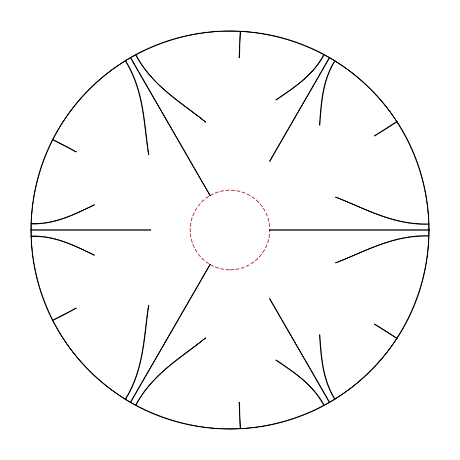

# An improved upper bound for the univalent Bloch–Landau constant

> **Status: private draft, not submitted or published.** The proof has been audited by an AI reviewer but not yet by a human mathematician. Please do not circulate.

This repository contains a slit domain, a computer-assisted proof, and all the code behind the bound

**U ≤ 0.65628589**

for the univalent Bloch–Landau constant U. For comparison:

| | Upper bound for U | Nature |
|---|---|---|
| Carroll and Ortega-Cerdà (2009) | 0.6563937 | proved (explicit formula, evaluated numerically) |
| Ortega-Cerdà and Pridhnani (2010) | 0.656319277 | numerical, no error analysis |
| **This repository** | **0.65628589** | computer-assisted proof, not yet refereed |



*The domain: a disc of radius 5.0011 with 24 slits. The dashed circle is a largest inscribed disc (radius 1).*

## What the constant is

Take any simply connected plane domain D containing 0. It has two sizes:

- **R(D)**, the inradius: the radius of the largest disc that fits inside D;
- **ρ(D)**, the conformal radius at 0: the size of D as felt from the point 0 (see the [primer](docs/PRIMER.md)).

The constant U is the smallest possible value of R(D) / ρ(D). Every explicit domain therefore gives an upper bound for U. The domain above has R ≤ 1 + 10⁻⁹ and ρ ≥ 1.523726208329.

## Where to start

| If you want to… | Read |
|---|---|
| see the theorem and its complete proof | [`paper/bloch_slit_discs.pdf`](paper/bloch_slit_discs.pdf) |
| understand the problem and the method without much background | [`docs/PRIMER.md`](docs/PRIMER.md) |
| re-run the proof and every numerical check yourself | [`docs/REPRODUCING.md`](docs/REPRODUCING.md) |
| see the earlier results and what was searched | [`docs/LITERATURE.md`](docs/LITERATURE.md) |

## Quick start

Requires Python 3.10 or later.

```
python -m venv .venv
.venv\Scripts\activate          (Windows)      source .venv/bin/activate   (Linux, macOS)
pip install -r requirements.txt
```

Run the proof (about one minute in total):

```
cd certify
python inradius_certificate.py G 1e-9
python conformal_certificate.py G 64
```

Expected last lines:

```
CERTIFIED: inradius of design G <= 1 + 1e-9
CERTIFIED: conformal radius of design G >= 1.523726208329
```

and (1 + 10⁻⁹) / 1.523726208329 < 0.65628589.

## Repository layout

| Path | Contents |
|---|---|
| `paper/` | the paper: LaTeX source and PDF |
| `certify/` | **the proof**: two programs, their logs and data files |
| `certify/inradius_certificate.py` | proves R(D) ≤ 1 + 10⁻⁹ (exact integer arithmetic) |
| `certify/conformal_certificate.py` | proves ρ(D) ≥ 1.523726208329 (ball arithmetic) |
| `certify/density_G_n64.json` | the coefficients used by the conformal-radius proof |
| `designs.py` | the three domains A, B, G: recomputes their ratios in floating point and draws them |
| `bloch_solver.py` | conformal radius of a slit disc (floating point); run it to see the self-test |
| `bloch_explicit.py` | exact conformal radius of the classical six-slit disc |
| `bloch_design.py`, `bloch_curved.py`, `bloch_curved2.py` | inradius routines and search objectives for straight, one-bend and two-bend slits |
| `bloch_evolve.py`, `bloch_evolve2.py` | differential-evolution searches (`bloch_curved2.py` contains the one that found G) |
| `bloch_verify*.py`, `bloch_residual.py` | floating-point cross-checks of a domain |
| `referee/` | scripts written by independent reviewers (different methods, no shared code) |
| `logs/` | logs of the searches and checks |
| `docs/` | primer, reproduction guide, literature notes |

Only the two programs in `certify/` are part of the proof. Everything else is how the domain was found and cross-checked.

## What is and is not established

- **Proved by the programs in `certify/`:** U ≤ 0.65628589. The argument is written out in the paper. It relies on the [Arb](https://flintlib.org) library (now part of FLINT, used through python-flint) for ball arithmetic and on Python's integer arithmetic.
- **Checked independently:** the inradius and conformal radius were recomputed by separately written code using different methods (`referee/`), and the proof and its programs were audited by a separate AI reviewer (`referee/certificate_audit/`), who found no fatal defect.
- **Not yet done:** review by a human expert; consulting Beller and Hummel's 1985 paper directly; a final literature check before submission.
- **Not claimed:** optimality. The domain is a local optimum of a small family.

## AI disclosure

The domain, the numerical method, the programs, the proof and the documents in this repository were produced with the help of an AI system (Claude, Anthropic), under the direction of the author, Wynand van Staden, throughout. The author has re-run the computations and checked the argument, and takes full responsibility for the results.

## Licence

No licence has been granted yet; all rights reserved until publication.
